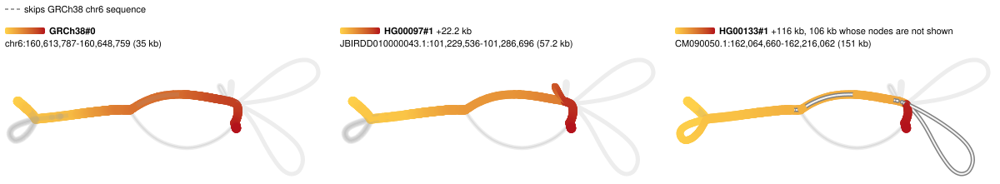

# @jbrowse/bandage-core

@jbrowse/bandage-core is the code that lays out and draws pangenome graphs in
the
[JBrowse graph plugin](https://github.com/GMOD/jbrowse-plugin-graphgenomeviewer),
[BandageJS](https://github.com/GMOD/BandageJS) and
[ggbandage](https://github.com/GMOD/ggbandage), packaged so you can build your
own viewer or figures with it.

- **In:** a pangenome graph as GFA, or a region of one read from a
  [gfa-to-tabix](https://github.com/GMOD/gfa-to-tabix) walk file with
  [@jbrowse/graph-walks](https://github.com/GMOD/graph-walks)
- **Out:** a layout of the graph, drawn on an HTML canvas (as in the JBrowse
  plugin and BandageJS), to an SVG file, or as tables of coordinates for another
  plotting library (ggbandage plots them with ggplot2)
- **Layouts:** Bandage's force-directed layout, which shows the graph's loops
  and bubbles, or layouts along the reference genome, such as one bar per
  haplotype or a tube map

## Install

```bash
npm install @jbrowse/bandage-core
```

Reading walk files also needs `@jbrowse/graph-walks`.

## Usage

The example below reads LPA's KIV-2 repeat from the HPRC release 2.1 walk file
on jbrowse.org and draws it with one panel per haplotype:

```ts
import {
  ENGINE_DEFAULTS,
  figureSvg,
  forceLayout,
  layoutEngine,
  loadGraph,
} from '@jbrowse/bandage-core'
import { WalkReader, walksKept } from '@jbrowse/graph-walks'

const reader = WalkReader.open(
  'https://jbrowse.org/demos/hprc/hprc-v2.1-mc-grch38-f8.GRCh38.walks.gz',
)
const refName = 'GRCh38#0#chr6'
const kiv2 = await reader.cut(
  refName,
  { start: 160_614_798, end: 160_647_758 },
  { keep: walksKept(['HG00097', 'HG00133'], refName) },
)
const graph = loadGraph(
  kiv2.graph.tables(kiv2.kept, kiv2.fragments, kiv2.departures),
  'KIV-2',
)
const { result } = await forceLayout(graph, ENGINE_DEFAULTS, layoutEngine)
const svg = figureSvg(graph, result, {
  walks: [
    { walk: refName },
    { walk: 'HG00097#1#JBIRDD010000043.1' },
    { walk: 'HG00133#1#CM090050.1' },
  ],
  facet: { field: 'walk', columns: 3 },
})
```



## Haplotype threads

Leave out `facet` in the example above, and `figureSvg` draws all three
haplotypes on one layout, each in a different color along the nodes it passes
through. Where haplotypes pass through the same nodes, their threads run side by
side, so a loop drawn in one color is a loop only that haplotype passes through.
On a canvas, passing `walkLift(graph, walks)` to `buildGeometry` as `highlight`
draws the same threads. A haplotype colored by `pass` splits into one thread per
trip round a repeat; see [Threading by pass](docs/drawing.md#threading-by-pass).


## Docs

- [API](docs/api.md): the main exports, by task: loading, layouts, drawing to a
  canvas, figures, haplotypes, and genes and variants
- [Walk rows and departures](docs/departures.md): where a haplotype leaves the
  reference, what the text beside each walk row means, and what a host app does
- [Drawing reference](docs/drawing.md): fitting a drawing to a pane, labels,
  small sites and threading by pass, for an app that draws with bandage-core
- [Command-line tools](docs/cli.md): `bandage-figure` draws a figure from a JSON
  spec, and `bandage-fold` merges small variants into the reference for viewing
  zoomed out

## See also

- [jbrowse-plugin-graphgenomeviewer](https://github.com/GMOD/jbrowse-plugin-graphgenomeviewer):
  browses these graphs by locus in JBrowse 2
- [BandageJS](https://github.com/GMOD/BandageJS): browses GFA files and walk
  files in a web browser
- [ggbandage](https://github.com/GMOD/ggbandage) (R): Bandage-style figures as
  ggplot2 layers

Similar project for tubemaps

- [@jbrowse/tubemap-core](https://github.com/GMOD/tubemap-core):
  sequenceTubeMap's layout, without the DOM

JBrowse tutorials;

- [HPRC part 1: graph alleles and haplotypes](https://jbrowse.org/jb2/docs/tutorials/pangenome_hprc/)
- [HPRC part 3: repeat lengths](https://jbrowse.org/jb2/docs/tutorials/pangenome_hprc_repeats/)

## License

GPL-3.0-or-later, as [Bandage](https://github.com/rrwick/Bandage) and
[OGDF](https://www.ogdf.uni-osnabrueck.de/) are.
