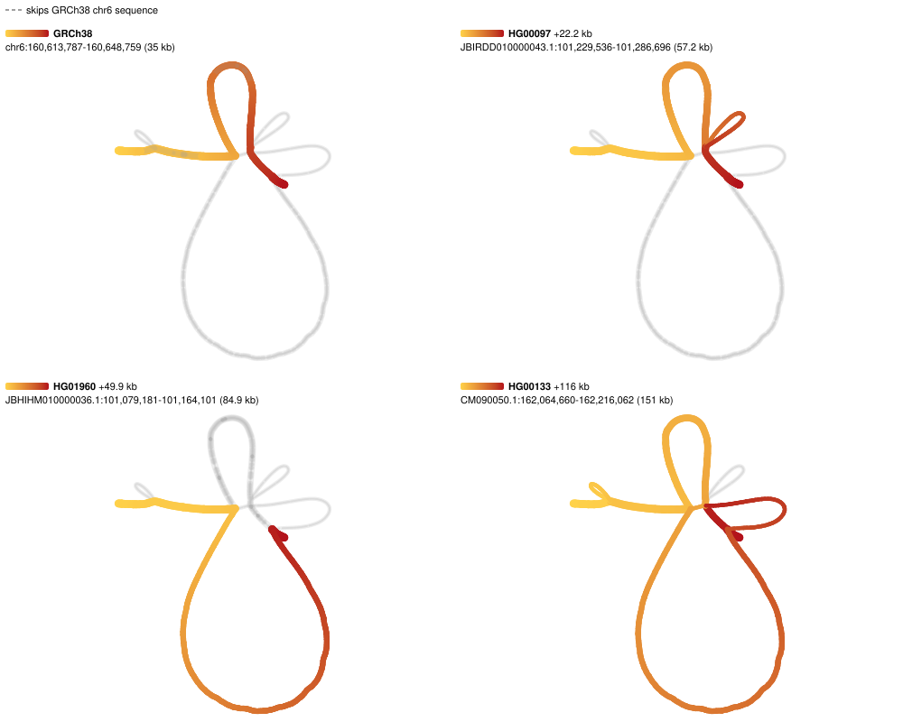

# Command-line tools

```bash
npx -p @jbrowse/bandage-core bandage-figure spec.json -o figure.svg
npx -p @jbrowse/bandage-core bandage-fold graph.rgfa.gz --below 10000 -o fold.gfa
```

- `bandage-figure` draws a figure from a JSON spec, with no browser
- `bandage-fold` folds every variant under `--below` bp into the reference, for
  the coarse tier a graph track draws when zoomed out

## bandage-figure

`bandage-figure`, in
[@jbrowse/bandage-core](https://www.npmjs.com/package/@jbrowse/bandage-core),
draws a pangenome graph to an SVG from a JSON spec, with no browser. It runs the
same layout engine, geometry and renderer the plugin and BandageJS draw the
screen with, so a figure matches what the viewer showed. Two runs of one spec
write identical files.

`bandage-figure` reads the graph from the GFA file a spec names under `gfa` or
the gbz-base window it names under `gbz`. To draw a cut from a walk file
(`.walks.gz`), write the cut as GFA with `graphTablesGFA` and name that file
under `gfa`.

```console
npx -p @jbrowse/bandage-core bandage-figure figures/kiv2_walks.json -o kiv2.svg
```

With [figures/kiv2_walks.json](../figures/kiv2_walks.json), `bandage-figure`
cuts LPA's KIV-2 repeat array from the HPRC release 2 gbz-base database and
lifts four walks through it, one panel each:

```json
{
  "gbz": {
    "db": "hprc",
    "region": "chr6:160,614,798-160,647,758",
    "haplotypes": ["HG00097#1", "HG01960#1", "HG00133#1"]
  },
  "layout": "force",
  "walks": [
    "GRCh38#0#chr6",
    "HG00097#1#JBIRDD010000043.1",
    "HG01960#1#JBHIHM010000036.1",
    "HG00133#1#CM090050.1"
  ],
  "facet": { "field": "walk", "columns": 2 },
  "width": 1000
}
```



Each panel shades its walk yellow where it starts and red where it ends, on the
same layout, so the panels show which loops each walk takes. GRCh38 takes the
small ones; HG00097 adds one (+22.2 kb); HG01960 skips most of GRCh38's for the
big one (+49.9 kb); HG00133 takes both (+116 kb).

### The spec

| Field                      | What it sets                                                                                                                                                                                                  |
| -------------------------- | ------------------------------------------------------------------------------------------------------------------------------------------------------------------------------------------------------------- |
| `gfa`                      | a GFA file (plain or gzipped) or url; a relative path is read from beside the spec                                                                                                                            |
| `gbz`                      | a window cut from a gbz-base database: `db` (a file, url or `hprc`), `index`, `region`, `haplotypes`, `referenceSample`, and a track's `context` and `snarls`                                                 |
| `genes`                    | a GFF3 or BED `file` or url, read by range through its `index` (`.tbi` or `.csi`) where there is one: the genes on the backbone, outlined and named                                                           |
| `genes.refNames`           | the file's name for a contig it names other than as the graph does, `{ "chr6": "NC_000006.12" }`; `6` for `chr6` needs none                                                                                   |
| `region`                   | the reference window a `gfa` was cut for, which the anchored layouts span. Both regions are 0-based and half-open, as in BED, so a browser's `chr6:160,614,798-160,647,758` is `chr6:160,614,797-160,647,758` |
| `referenceName`            | what the reference-position key and the walk keys call the reference, such as `hg38 chr6`; by default the sample a named backbone lies on and its one contig, `GRCh38 chr6`                                   |
| `referencePath`            | the path a walk graph is drawn along                                                                                                                                                                          |
| `layout`                   | a layout mode: `force` (the default), `auto`, `ordered` or `samplerows`                                                                                                                                       |
| `quality`, `bubbleSpread`  | the force-directed engine's settings; `engine` picks `fmmm` (Bandage, the default) or `stress`                                                                                                                |
| `spacing`                  | the engine's link length, as a multiple of its default                                                                                                                                                        |
| `componentSeparation`      | the engine's gap between a graph's disconnected pieces, as a multiple of its default                                                                                                                          |
| `walks`                    | the walks to lift: names, or `{ "walk", "color": { "field", "scheme" } }` layers                                                                                                                              |
| `facet`                    | `walk` (a panel per walk) or `sample` (a row per sample, a column per haplotype), bare, or `{ "field", "sort", "columns" }`: the walks or samples whose panels come first, and how many go across by walk     |
| `width`, `height`          | the figure's width, and the most height it may take                                                                                                                                                           |
| `colorScheme`, `nodeWidth` | as the view's Color menu and node width setting; `nodeWidth: "frequency"` draws each node as wide as the share of haplotypes that pass it                                                                     |
| `frequencies`              | passes per haplotype by segment name, `{ "146684935": 0.5 }`, which override a segment's `AF` tag and what the walks give                                                                                     |
| `contigThickness`          | a node's drawn width in px, 6 by default                                                                                                                                                                      |
| `showDeletionEdges`        | `false` lays out and draws the graph without the edges that skip reference sequence, but for any that alone join their ends                                                                                   |
| `walkStrip`                | walk rows in a strip under a layout that draws nodes, each haplotype's walk on its own bp; a `gbz` cut then follows whole walks unless `snarls` says otherwise                                                |
| `walkRowSamples`           | the samples the strip keeps, in the order it draws them                                                                                                                                                       |

A spec's `genes` are the backbone's, so in a walk strip `bandage-figure` boxes
them on the reference row only, and the key labels the other rows "no gene
track".

`bandage-figure` writes the spec into each SVG's `<metadata>` beside the version
that drew it, such as `@jbrowse/bandage-core@4.0.25`. To make a figure again,
run that version on the spec:
`npx -p @jbrowse/bandage-core@4.0.25 bandage-figure spec.json`.

In jbrowse-plugin-graphgenomeviewer and BandageJS, **Export SVG** saves the
drawing through the same renderer, with no spec. `bandage-figure` refuses a
layout that draws no nodes, such as walk rows or a tube map (`checkLayout`).

After `pnpm build`, `node scripts/render-figures.mjs` renders every spec in
[figures/](../figures) to `img/figure_<name>.svg`.

## bandage-fold

`bandage-fold` writes an rGFA with every variant under `--below` bp folded into
the reference. Indexed by gfa-to-tabix, the output is the coarse tier a graph
track draws once zoomed out past the fine index, so a whole chromosome fits.
[`gfa-to-tabix fold`](https://github.com/GMOD/gfa-to-tabix/blob/main/docs/subcommands.md#fold)
documents the fold and the handover from the fine index.

```console
npx -p @jbrowse/bandage-core bandage-fold graph.rgfa.gz --below 10000 \
  | gfa-to-tabix - -o graph.fold10000
```

- The input is a GFA or rGFA, plain or gzipped, or `-` for stdin. `-o out.gfa`
  writes a file in place of stdout
- `--reference PATH` names a plain GFA's backbone path. In an rGFA, the segments
  tagged `SR:i:0` form the backbone
- The fold keeps the backbone, every allele whose own length or the reference it
  replaces reaches `--below`, and the shortest way from each one's ends back to
  the backbone. It joins the reference between kept alleles into one segment
- `bandage-fold` drops paths and walks from the output. It writes forward a
  segment that a plain GFA's path reads reversed, and flips its links to match,
  so the output re-reads as the graph that was folded
- gfa-to-tabix's `--layout anchored|contig` should match the fine index's. An
  anchored window inside a large bubble then returns the whole bubble in both
  tiers, and a contig one only what links reach from it
- The graph track folds each cut it draws at ten pixels (`FOLD_PX` in
  jbrowse-plugin-graphgenomeviewer), and folding a fold again at a larger size
  closely matches folding the original at that size. A tier folded at N and
  handed over at N / 10 bp per pixel, such as
  `coarse: { uri: "graph.fold10000", aboveBpPerPx: 1000 }`, therefore draws
  nearly what the fine cut drew
- Node caps a string at 512 MB, and `bandage-fold` reads the whole graph into
  one, so it cannot fold a whole human pangenome. `gfa-to-tabix fold`, a port of
  the same fold, writes the index in one pass:
  `gfa-to-tabix fold graph.rgfa.gz --below 10000 -o graph.fold10000`
