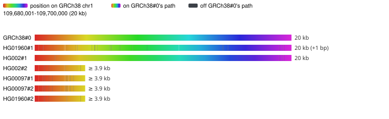

# Walk rows and departures

A departure is a place where a haplotype leaves the reference and rejoins it.
Seen from the reference, each deletion, insertion, inversion and duplication is
a departure. A walk-file cut returns every departure over its window, with the
two breakpoints on the reference and the bp of the haplotype's own sequence
between them.

- Where both ends of a departure lie in the window, bandage-core draws it in the
  walk row
- Where an end lies outside the window, bandage-core uses the departure in the
  row's readout to give where the walk goes and how long it is

## The GSTM1 deletion

In the HPRC graph, HG002#2, HG00097#1, HG00097#2 and HG01960#2 have the GSTM1
deletion, 18 kb from chr1:109,683,912 to 109,702,357. A cut of
chr1:109,680,000-109,700,000 ends before the deletion rejoins the reference, so
those rows stop after 4 kb. bandage-core labels each one `≥ 4.0 kb`, a lower
bound, and `goes on near chr1:109.7 Mb · 0 bp of its own`: the walk rejoins the
reference near 109.7 Mb with no sequence between, which is a deletion.

A cut to 109,720,000 holds both ends of the deletion, so bandage-core draws the
same rows 18 kb shorter than GRCh38:

## Readout words

| Readout                                 | Meaning                                                                                                |
| --------------------------------------- | ------------------------------------------------------------------------------------------------------ |
| `≥ 4.0 kb · goes on near chr1:109.7 Mb` | the walk leaves the window at a departure that rejoins the reference near that position                |
| `0 bp of its own`, `120 kb of its own`  | the haplotype's own sequence between a departure's ends; 0 bp is a deletion                            |
| `no step on GRCh38 across 54 kb`        | a departure spans the whole window, so the row is a hairline between its ends                          |
| `left out of graph`                     | bp of the haplotype's own sequence that the graph lacks                                                |
| `out of view`                           | bp the cut trimmed at the edge of the window                                                           |
| `near chr22:20.3 Mb`, in a gap          | bp the walk spends on the reference elsewhere, rejoining it near that position                         |
| `own sequence not drawn`                | bp of the haplotype's own sequence that the cut did not read                                           |
| `placement choice`                      | a departure ends on a node the reference passes more than once, and the file's writer chose which pass |
| `nodes not shown`, `· not compared`     | the row holds a piece the cut did not load                                                             |

## Pieces not loaded

gfa-to-tabix abridges the heaviest walks in a tile, usually a satellite array,
and a cut that does not expand such a walk gets the bp of each piece but not its
nodes. bandage-core draws the piece in hollow, untinted grey: a bar in walk
rows, a `placeholder` node in a node layout, and a dashed box captioned
`nodes not shown` in the tube map. Ribbons, shared blocks and the shared row
order compare nodes, so they leave out a row with such a piece, and its readout
ends `· not compared`.

## What a host does

- Pass `departures` through to `loadGraph`. `GraphTables` requires them, and a
  source with none, such as GFA text, passes `departureTable()`
- Place each row's readout with `walkRowReadoutAt`, which cuts the text to the
  room beside the bar by whole parts
- Show each row's `departures` on hover
- When `rowsNeedingRoutes(rows)` is above zero, load those rows' `abridgedSteps`
  before relying on ribbons or the shared row order
- Draw a placeholder in a key as `NOT_LOADED_CSS` around `NOT_LOADED_FILL_CSS`,
  named `NOT_LOADED_TEXT`
- Write a GFA for another tool from a cut with every piece loaded.
  `graphTablesGFA` tags a placeholder's S line `nl:i:1`, which other tools
  ignore, so they read the line as a real segment
