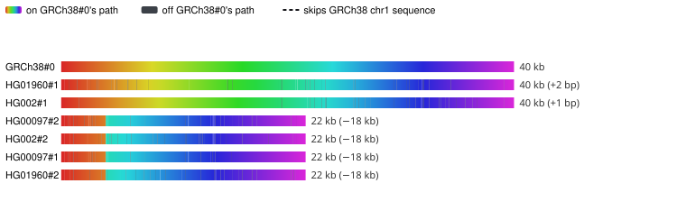

# Walk rows and departures

A walk row is a bar for one haplotype, showing how much sequence it has across
the region you are viewing. When bandage-core reads a region from a walk file,
it also gets each haplotype's departures: the places where the haplotype stops
following the reference, and where it starts following it again. Every deletion,
insertion, inversion and duplication is a departure.

- When both ends of a departure are inside the region, the bar shows the variant
  directly
- When one end is outside the region, the bar stops early, and the text beside
  it starts with `≥`: the haplotype runs on past the edge. Its hover says where
  it goes next, so the short bar does not read as a deletion
- Each bar is the haplotype's own sequence at one scale for every row, not the
  ruler's: a bar holding an insertion is longer than the region, and one with a
  deletion shorter. Every bar starts at the left edge; its colors say where on
  the reference each part of it lies
- A haplotype that crosses the region more than once, as a contig with a
  duplication or an inversion can, is one bar from its first base in the region
  to its last. A trip it takes away from the region in between is a thin gap no
  wider than one width, marked `//` where it is drawn shorter than it is, and a
  stretch it walks against the reference's direction runs its colors backwards
  under white chevrons

## A deletion at GSTM1

In the HPRC graph, HG002#2, HG00097#1, HG00097#2 and HG01960#2 lack 18 kb of
GRCh38 around GSTM1, from chr1:109,683,912 to 109,702,357.

In the region chr1:109,680,000-109,700,000, the deletion starts inside the
region and ends 2.4 kb past it. The four bars stop after 3.9 kb, and the text
beside each reads `≥ 3.9 kb`: at least 3.9 kb of the haplotype is in view. The
hover over each adds `goes on near chr1:109.7 Mb`: the haplotype follows the
reference again near 109.7 Mb, and the hover names no sequence of its own in
between, so this is a deletion.

In the wider region chr1:109,680,000-109,720,000, both ends of the deletion are
inside the region, and the four bars are drawn 18 kb shorter than GRCh38:

## The text beside a bar

In a bar, the rainbow colors are positions on the reference, and charcoal is
sequence off the reference. White chevrons pointing left mark a stretch the
haplotype walks against the reference's direction, where its colors run
backwards. A row reads its contig in the order it is stored, so a contig stored
back to front has chevrons from end to end, and its colors run from high to low.
Every bar starts at the left edge, on a scale of its own.

The text beside a bar is one line:

| Text             | Meaning                                                                                                                        |
| ---------------- | ------------------------------------------------------------------------------------------------------------------------------ |
| `22 kb`          | the haplotype's sequence the bar shows                                                                                         |
| `≥ 3.9 kb`       | the haplotype's contig runs on past one end of the bar                                                                         |
| `22 kb (−18 kb)` | the haplotype crosses the whole region, none of it away, and is this much longer or shorter than the reference over the region |
| `// 853 kb`      | the haplotype's sequence away from the region between two stretches in it, which the bar leaves out                            |

Everything else is in the hover over the bar:

| Text                                                | Meaning                                                                                                                                                                                                                                                                                         |
| --------------------------------------------------- | ----------------------------------------------------------------------------------------------------------------------------------------------------------------------------------------------------------------------------------------------------------------------------------------------- |
| `5199 kb of its contig`                             | a bar that leaves the region and comes back: its contig from its first base in the region to its last                                                                                                                                                                                           |
| `first pass: 4.0 kb · passes again: 0 bp (−4.0 kb)` | each time such a haplotype crosses the region, measured over the region, a pass that skips it included                                                                                                                                                                                          |
| `goes on near chr1:109.7 Mb`                        | where the haplotype follows the reference again, outside the region                                                                                                                                                                                                                             |
| `comes from away from the window`                   | the haplotype's contig runs on before the start of the bar; no place is given for it                                                                                                                                                                                                            |
| `turns back out of the window`                      | the haplotype comes into the region and leaves it on the same side                                                                                                                                                                                                                              |
| `120 kb of its own`                                 | the haplotype's sequence between leaving the reference and following it again; nothing is said of a jump with none                                                                                                                                                                              |
| `no step on GRCh38 across 54 kb`                    | the haplotype skips the whole region, so it is drawn as a thin line between where it leaves and returns                                                                                                                                                                                         |
| `contig starts inside the window`                   | the haplotype's contig begins at the bar's end                                                                                                                                                                                                                                                  |
| `9183 kb before it not drawn or left out of graph`  | the haplotype's contig goes on before the bar's end, in sequence that is missing from the graph or in pieces that never follow the reference                                                                                                                                                    |
| `no more of the contig on GRCh38 chr22`             | the walk file holds none of the haplotype's contig past the bar's end on that reference sequence; a GFA, which states nothing past a path's end, gets no such text                                                                                                                              |
| `of which 4.0 kb reversed`                          | the bar's bp walked against the reference's direction, drawn with chevrons                                                                                                                                                                                                                      |
| `743 kb away from the window`                       | sequence the haplotype walks outside the region, on the reference or off it, between two stretches in the region                                                                                                                                                                                |
| `538 kb not drawn or left out of graph`             | sequence between two stretches in the region that the departures read do not account for: it may lie outside the region or be missing from the graph                                                                                                                                            |
| `left out of graph`                                 | sequence of the haplotype that is missing from the graph                                                                                                                                                                                                                                        |
| `at least 600 bp left out of graph`                 | the cut did not read every departure across the gap, so more may be missing                                                                                                                                                                                                                     |
| `own sequence not drawn`                            | sequence of the haplotype that was not loaded with the region                                                                                                                                                                                                                                   |
| `off GRCh38's path`                                 | replaces `of its own` and `own sequence not drawn` when the walk file counts reference nodes the reference passes more than once, as in a collapsed repeat; sequence off the reference may then be a copy of that repeat. `walkRows` takes a `revisited` option that overrides the file's count |
| `1.0 kb GRCh38 from elsewhere`                      | reference sequence the haplotype follows at another pass of the reference, outside the region; it is drawn off the path, and counted as reference sequence                                                                                                                                      |
| `· 20 departures on 4 other contigs`                | on a haplotype's first row: departures in the region from its other contigs, which are not given separate rows                                                                                                                                                                                  |
| `placement choice`                                  | the haplotype leaves or returns at a node the reference passes more than once, and the file's writer picked which pass                                                                                                                                                                          |
| `nodes not shown`, `· not compared`                 | part of the haplotype was loaded as a length only (see below)                                                                                                                                                                                                                                   |

## Parts loaded as a length only

Where some haplotypes pass through very many nodes, usually in a satellite
array, gfa-to-tabix stores those haplotypes' nodes separately. A viewer that
does not ask for them gets only the length of each such part. bandage-core draws
it hollow and grey: as a bar in walk rows, a node in the graph layouts, and a
dashed box labelled `nodes not shown` in the tube map. bandage-core builds
ribbons, shared blocks and the shared row order by comparing nodes, so it leaves
these haplotypes out of them and ends the text beside their bars with
`· not compared`.

## For a host app

- Pass `departures` to `loadGraph` with the rest of the tables. The field is
  required, so for a source with no departures, such as GFA text, pass
  `departureTable()`
- Place the text beside each bar with `walkRowReadoutAt`: it gives the line to
  draw, cut by whole parts only where there is no room, and the full text for
  the hover. `walkRowsExtent`, given the width the bars and lines have, makes
  the bars short enough that every line fits
- Show each row's `departures` in its hover text
- When `rowsNeedingRoutes(rows)` is above zero, load those rows' `abridgedSteps`
  before relying on ribbons or the shared row order
- In a key, draw the hollow grey as `NOT_LOADED_CSS` around
  `NOT_LOADED_FILL_CSS`, labelled `NOT_LOADED_TEXT`
- Load every part before writing a GFA for another tool. `graphTablesGFA` tags a
  part loaded as a length only with `nl:i:1` on its S line, which other tools
  ignore, so they would read it as a real segment
