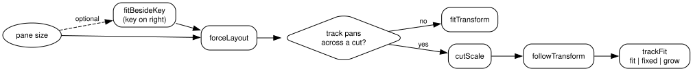
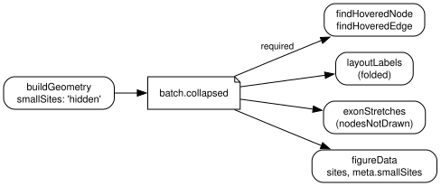

# Drawing reference for host apps

For apps that draw with bandage-core on a canvas or export what their pane
shows. [API](api.md) lists the main exports.

## Fitting a drawing to a pane



- Pass `forceLayout` the pane size you will give `fitTransform`. Some spacing is
  set in px at that size, so the same size always gives the same layout. With no
  size, it uses the default figure width and a JBrowse track's default height
- The stress engine lays the reference straight and moves off-reference nodes
  clear of it (`clearOfReference`). FMMM bends the reference, so nodes stay
  where FMMM put them
- If your key runs down the pane's right edge, take the size from `fitBesideKey`
  (the pane minus the key's column) and pass it to both `fitTransform` and
  `forceLayout`. Nothing is then drawn or labelled under the key

### A track that pans across a larger cut

When a track loads more graph than its window shows, place the drawing with
`cutScale` and `followTransform` instead of `fitTransform`.

```
 cut     |================================================|
 window          [=========]  →  pan slides, zoom scales
 pane            |  ~~~~~~~~ |   same scale for every window
```

- `cutScale` picks one scale for every window of the view's width in the cut, so
  panning never rescales. It depends on the width, not the position
- `followTransform` only translates: the window's reference lines up with its bp
  across the pane, and never slides past the pane's edges
- `referenceProfile` gives the drawn reference in bp order; `shownBounds` gives
  what any window can show

### Track height (`trackFit`)

```
 fit      fixed (default)      grow
┌─────┐   ┌─────┐              ┌─────┐
│ ═╦═ │   │ ═╦═ │ ← clipped    │ ═╦═ │
│  ╚═ │   └─────┘   below      │  ║  │
└─────┘                        │  ╚═ │ ← pane grows to cap
 whole     reference kept      └─────┘
 cut fits  in view
```

- `fit`: the whole cut fits the height; nothing is clipped
- `fixed` (`DEFAULT_TRACK_FIT`): draws at the window's scale, lowered only so
  the reference fits (`referenceScale`). `windowTranslateY` keeps the reference
  in view (`referenceReach`); what hangs past the top or bottom is clipped, and
  `edgeOverruns` says where
- `grow`: like `fixed`, in a pane as tall as needed (`grownHeight`), up to your
  cap

## Links, skips and region edges

- Arrowheads show link direction. A simple one-way chain gets one head per
  `LINK_HEAD_SPACING_PX`, so short nodes don't look like a dashed skip.
  Branching links, skips and strand-flipping links always keep their heads
- A skip whose route would lie over the nodes it skips (within
  `ALONG_STRETCH_PX`) is drawn as an arch instead
- With walks, every skip is one solid arch in link ink at its walks' width,
  painted over the nodes (`arch` on the stroke). The key shows it as a small
  arch, `skips GRCh38 sequence`. Without walks, as the rGFA track draws, a skip
  long on screen is dashed and a short one is a plain stroke
- With walks, a skip or padded arm short on screen is a low arch over its feet,
  no wider than its chord and no higher than it is long. Where its span is under
  `SKIP_LEVEL_PX` or three times its stroke, it draws as the plain link it is,
  under the nodes, so the path its walks take, and an allele they carry, stays
  joined to the reference. The key counts it as not drawn
  ([Small sites](#small-sites))
- Where a haplotype runs on past the cut, its loose end gets a dark tab. The key
  calls it `graph runs on past what is drawn`; `figureData`'s `arrows` table
  marks it `runsOn`

## Placeholders

A placeholder stands for walk sequence not loaded with the region.

- Drawn hollow and grey (`placeholder` on the node), so it can't pass for real
  sequence. Key it with `NOT_LOADED_CSS`, `NOT_LOADED_FILL_CSS` and
  `NOT_LOADED_TEXT`. In the tube map it is a dashed box,
  `300 bp · nodes not shown`
- Its length is labelled, longest first, while there is room. Nearby
  placeholders share one label. `layoutLabels` returns the rest as `unlabelled`;
  pass that to `graphKey` to show `N unlabelled, X or less each`
- `loadGraph`'s `maxNodes` counts placeholders
- `graphTablesGFA` tags placeholders `nl:i:1`, which other tools ignore. Export
  GFA for other tools from a fully loaded cut

## Labels

- A loop where a walk leaves the reference and returns (`walkLoops`) shows its
  length once it is drawn big enough (`SMALL_SITE_PX`). The label sits on the
  loop, else beside it with a leader line, else nowhere. Nested loops show a
  range, `20.5–20.9 kb`
- `layoutLabels` needs walks from `graph` and the painted batch as `drawnInk`.
  Use `sameInkOnPane` to skip relayout when a rebuilt batch looks the same
- Genes are named at their pin, or the nearest visible point. A gene partly in
  the cut says how much is drawn: `8.2 kb of 1.4 Mb`. Later copies of a
  collapsed repeat get exons but no name (`GenePin.anchored`)

## Small sites

At overview, the drawing shows structure, not every SNP.

```
 zoomed out:   ════════════════      (sites under SMALL_SITE_PX hidden)
 zoomed in:    ═══╦═══╦══╗═══════
                  ╚═══╝  ╚═ (allele, skip drawn again)
```



- With `smallSites: 'hidden'` (default), `buildGeometry` hides a site (an
  off-reference piece or a skip) whose bp comes to less than `SMALL_SITE_PX` at
  the reference's px per bp, however long the layout draws it.
  `smallSites: 'nodes'` draws every node
- Never hidden: the reference, links that turn it back on itself, unwalked
  parts, strand flips, pieces reaching another reference or an unloaded node,
  structure leading out of the cut, and anything of 0 bp
- Overlapping hidden sites merge into a run, drawn as one even reference line
  (`collapsed.through`, `collapsed.bridges`). Lifted walks cross a run as one
  plain lane
- Hiding depends only on layout and scale, so each node changes state at most
  once during a zoom
- The key adds `N nodes and M skips under B bp not drawn` when anything in view
  is hidden or a skip in view is too short on screen to arch, in either mode
  (`collapsed.shortSkips`). With walks, each skip is drawn as its arch or
  counted there, never both or neither. Everything counted is under B bp, and
  every site and skip of B bp or more is drawn. Hidden nodes get no labels and
  push none aside
- Pass the batch's `collapsed` to `findHoveredNode` and `findHoveredEdge`, and
  its nodes to `layoutLabels` as `folded`. `exonStretches` takes
  `nodesNotDrawn(batch)` so exons aren't outlined on hidden nodes. `figureData`
  lists hidden sites in `sites` and the setting in `meta.smallSites`
- Lifted lanes are never thinner than `MIN_LANE_STROKE_PX`

## The key

The key describes exactly what the pane shows.

- If the pane shows part of the drawing, pass `drawnMarks` a `keyedView`: the
  pane under the reference strip in layout units, key column included. If you
  clip the drawing, pass the width you paint
- `figureSvg` and `figureData` key the whole drawing
- If the pane grows to fit the key, size it for the whole layout, not each view,
  so panning never resizes it. A taller key scrolls

## Threading by pass

A haplotype that loops round a repeat steps on the same nodes once per trip.
With `color: { field: 'pass' }`, its lane splits into one coloured thread per
trip.

```
 node A  ══ pass 1 ══
         ══ pass 2 ══   one thread per visit
         ══ pass 3 ══
```

- `passesOf(walk, lengthOf)` finds passes from the walk alone. A new pass starts
  when the walk returns to a node already visited in this pass. Only repeated
  nodes take pass colours
- Each pass has `repeatBp`, `againBp`, `reversedBp` and `reversed` (data only;
  strand is relative to the walk's first visit, so arrowheads, not this flag,
  show direction on the page)
- Up to six passes get their own colour and name (`pass 1`…, or `passNames`).
  The key and bar add bp, as `pass 3 · 61 bp`. Further passes share a colour
- Pass colours come from Okabe–Ito then Tol, kept apart from lane colours
  (`PASS_FROM_WALK`) and each other (`PASS_FROM_PASS`) in OKLab
- `layoutLabels` names passes, `graphKey` keys them, and `passBars` /
  `passBarTree` draw a bar marking each pass's stretches
- Arrowheads show walk direction on reversed nodes and on every pass thread,
  black or white for contrast, or haloed when wider than the lane
- A graph that keeps each repeat copy as separate nodes shows no passes. Supply
  them with a layer's `passes`
- Pass count is not copy number: it depends on which nodes the graph shares
  between copies
- `figureData` adds `pass`, `visit` and `walkPass` to lane rows, plus `passes`,
  `passRuns` and `pass` labels (not for faceted figures)

## Exporting what a pane shows

Pass `figureSvg` the pane's size and transform as `frame` to export exactly what
the pane shows, key included. Without `frame` it fits the whole drawing.
